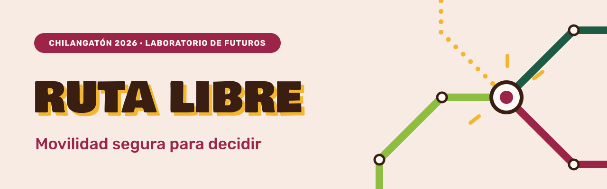

# Chilangatón: tecnología e innovación social para futuros de la Ciudad

## El encuentro

**Fecha:** 25 de octubre de 2026, desde las 8:00  
**Sede:** UTOPÍA Elena Poniatowska Amor, Av. Miguel Hidalgo 128, San Lucas, Coyoacán, 04100, Ciudad de México  
**Organizan:** Secretaría de Educación, Ciencia, Tecnología e Innovación (SECTEI) y Secretaría de Desarrollo Económico (SEDECO) de la Ciudad de México  
**Página:** [luma.com/j55anly0](https://luma.com/j55anly0)

El evento reúne a estudiantes, especialistas, investigadores, emprendedores, desarrolladores, diseñadores y agentes de cambio en torno a la tecnología, la innovación, la creatividad y la investigación. Cuenta con dos tracks:

- **Hackatón — «Sumar al presente. Construir soluciones para la ciudad.»** Los equipos trabajan uno de los retos de la CDMX, elegido el día del evento; las soluciones deben centrarse en las personas, ser viables con recursos accesibles y poder demostrarse en un prototipo.
- **Laboratorio de Futuros — «Imaginar el mañana. Diseña la ciudad que queremos.»** En mesas se imaginan dos futuros para 2040, uno indeseable y otro deseable; después se discute qué haría falta para alcanzar el deseable y evitar el indeseable.

## RUTA LIBRE

El equipo participa en el Laboratorio de Futuros; el enfoque para el ejercicio de 2040 sigue en definición. El proyecto se llama **RUTA LIBRE** y lleva el lema «Movilidad segura para decidir».

Es una herramienta digital que conecta información verificada sobre aborto, opciones de transporte público y orientación libre de estigmas; busca hacer visibles las condiciones reales de acceso en la Zona Metropolitana del Valle de México, sin exigir identidad ni ubicación exacta. La pregunta de fondo incluye si una persona puede llegar al servicio en sus propias condiciones: tiempo, costo, transbordos y horarios, además del regreso.

La información tendrá fuente y fecha de verificación; ningún trayecto se etiquetará como «seguro» sin evidencia. El punto de partida será una estación de referencia, sin cuenta ni GPS.

## Equipo

- Paula Camila Alós Villalba
- Ana Victoria Avila Alvarez
- Francisco Fernando Guzmán Villanueva
- Santiago García Arellano

## Criterios de evaluación

Los criterios con los que se evaluará la propuesta (Laboratorio de Futuros y Hackatón) están en [`docs/criterios-evaluacion.md`](docs/criterios-evaluacion.md).

## Contenido del repositorio

Este repositorio reúne la evidencia del trabajo del equipo durante el evento; también sirve como evidencia para Cattion. Los documentos se guardarán en `docs/` y, si aplica, aquí se incluirá código.

Lista de documentos y pendientes: [`docs/documentos.md`](docs/documentos.md). Bases del evento: [`docs/CHILANGATON-EXT.pdf`](docs/CHILANGATON-EXT.pdf).
